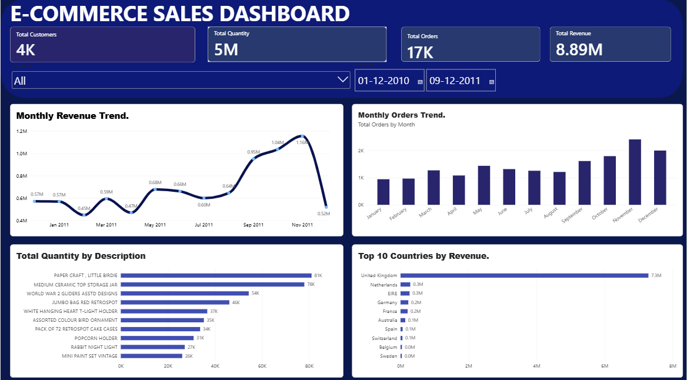

# E-commerce Sales Analysis

## Project Overview

This project analyzes e-commerce transaction data to understand sales performance, customer behavior, product demand, and revenue trends.

## Objectives

- Clean and prepare sales data.
- Analyze revenue and customer transactions.
- Identify top-selling products and countries.
- Analyze monthly sales trends.
- Create an interactive Power BI dashboard.
- Provide business recommendations based on the results.

## Tools and Technologies

- Python
- Pandas and NumPy
- Matplotlib and Seaborn
- SQL (SQLite)
- Power BI
- Google Colab

## Dataset

UCI Online Retail Dataset

Source: https://archive.ics.uci.edu/dataset/352/online-retail

## Project Workflow

1. Data Collection
2. Data Cleaning
3. Exploratory Data Analysis
4. SQL Analysis
5. Data Visualization
6. Power BI Dashboard
7. Business Insights

## Dashboard

## Dashboard

## Key Findings

ECOMMERCE SALES REPORT
----------------------
Total Revenue: 8885586.15
Total Orders: 17282
Average Order Value: 514.15

Top Country:
Country
United Kingdom    7283438.304
Name: TotalSales, dtype: float64

Top Product:
Description
PAPER CRAFT , LITTLE BIRDIE    168469.6
Name: TotalSales, dtype: float64

Top Customer:
CustomerID
14646.0    280206.02
Name: TotalSales, dtype: float64

## Conclusion

This project demonstrates how Python, SQL, and Power BI can be combined to analyze business performance and support data-driven decisions.
